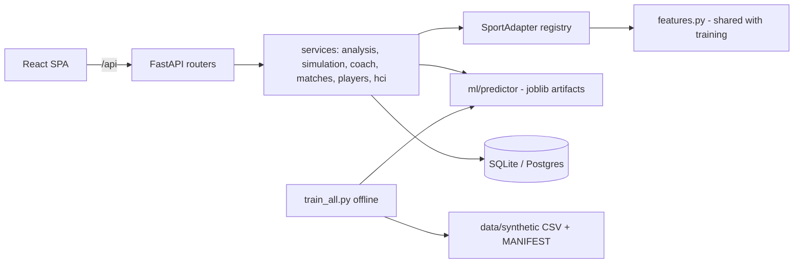

# Architecture

```
React SPA (Vite)  ──/api──▶  FastAPI  ──▶  services  ──▶  SportAdapter (cricket|football|basketball)
                                │                              │
                                │                              ├─ features.py   state → feature vector (shared by training & serving)
                                │                              ├─ apply_event   deterministic what-if state transitions
                                │                              ├─ rollout       Monte-Carlo continuation (synth simulators)
                                │                              └─ momentum / insights / scoreboard
                                ├─ ml/predictor  loads artifacts/*.joblib   (WinPredictor, PlayerModels)
                                └─ SQLModel      Match, Player, PlayerGame, SimulationRun, HciSession, HciTaskResult
```



**DB entities:** `Match`, `Player`, `PlayerGame`, `SimulationRun`, `HciSession` (participant code, condition, experience, consent, SUS, trust items, feedback), `HciTaskResult` (answer, correct, time, confidence, trust, interactions, position). New columns are added to existing SQLite files by `db._add_missing_columns()`.

## Sport Adapter

`backend/app/sports/base.py` defines the contract each sport implements: a validated Pydantic state model, `features(state)`, outcome labels, `terminal(state)`, `momentum(state)`, `insights(state)`, `apply_event(state, event)`, `rollout(state, rng, …)`, and coach candidates. `registry.py` maps `"cricket" | "football" | "basketball"` to adapters, so services and routers contain no sport-specific branching. Adding a sport = a simulator, an adapter, a feature function and one registry line.

## Request flows

**Predict** `POST /api/{sport}/predict` → validate state → `features` → `WinPredictor.proba` (+ bootstrap band) → sampled-Shapley explanation → momentum + insights → one response.

**What-if** `POST /api/{sport}/simulate` → `apply_event` per event → recompute features → `predict_proba` → Shapley attribution of the *change* (`attribute_change`) → narrative. The sweep endpoint evaluates every event in one batch. The prediction pipeline is the same code path as `/predict`; nothing is looked up or pre-written.

**AI Coach** `POST /api/{sport}/coach` → for each candidate action run N rollouts with the same simulators → score end states with the model → rank by mean objective (win probability; expected points in football) → confidence = Φ(z) of best vs runner-up, clipped to [0.5, 0.99]. Always labelled "AI-assisted recommendation".

**Match replay** `GET /api/matches/{id}/series` evaluates the model at every stored timeline step (cached per match); `/steps/{k}` returns the full explanation for one step.

## Frontend

Vite + React 18 + TypeScript + Tailwind. `MatchProvider` holds the selected match, step, playback and the current analysis for all `/app/:sport/*` pages. Pages are lazy-loaded. Every data component handles loading, error (with retry) and empty states. `MotionConfig reducedMotion="user"` honours the OS setting. Routes: `/`, `/sports`, `/app/:sport/{match,analytics,simulate,players}`, `/models`, `/hci`.

## Security and robustness

* Pydantic validation on every request body, with domain validators (e.g. goals ≤ shots on target, balls ≤ 120, wickets ≤ 10).
* `slowapi` rate limits (`RATE_LIMIT`, `HEAVY_RATE_LIMIT`), CORS restricted to `CORS_ORIGINS`.
* Structured JSON errors for validation, not-found and rate-limit cases; no stack traces in responses.
* Secrets only via environment; `.env` is git-ignored. No authentication is implemented — the HCI endpoints are open and intended for supervised study use, so put them behind auth before any public deployment.
* HCI stores an anonymous code and responses only; consent is required and recorded; exports are protected against spreadsheet formula injection.
* `/api/health` reports `degraded` and prediction endpoints return `503 artifact_missing` if a model file is missing or corrupt, instead of a 500.

## Reproducibility

Seeds are fixed per sport (`metrics.json → meta.seeds`); the dataset hash of each generated table is recorded; training is offline (`python -m app.ml.train_all`) and the API only loads artifacts.
