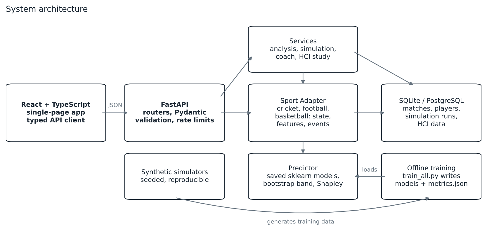
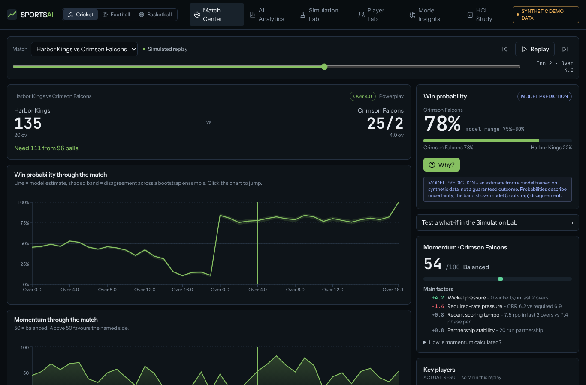
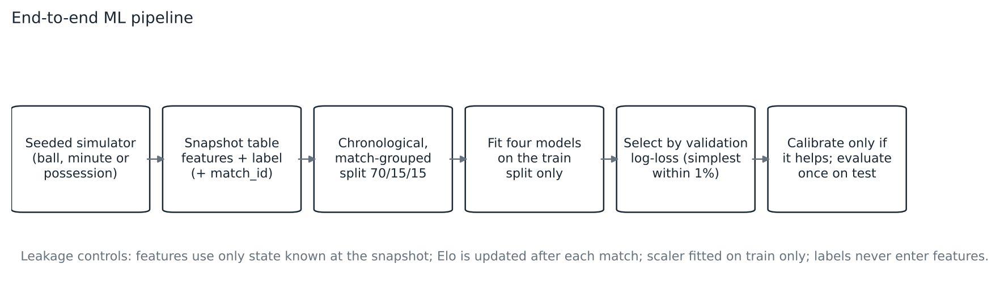
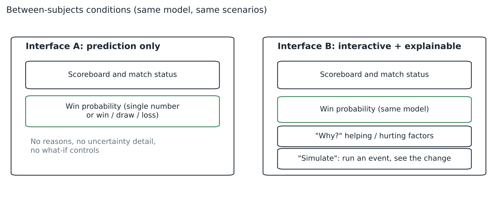
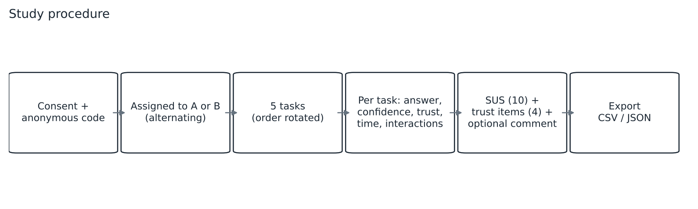
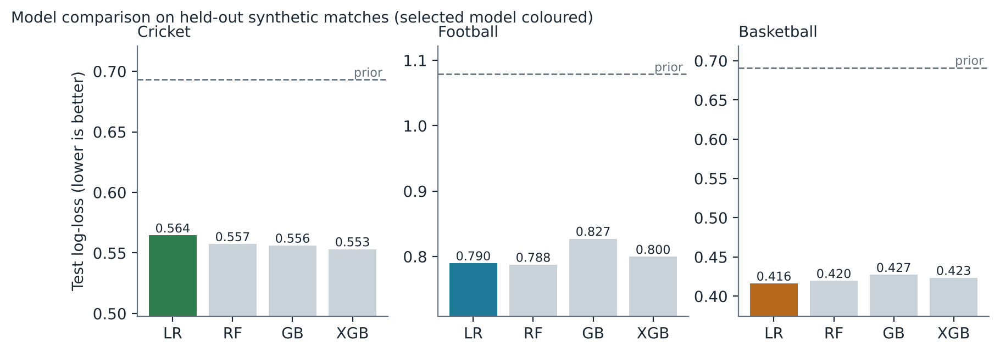
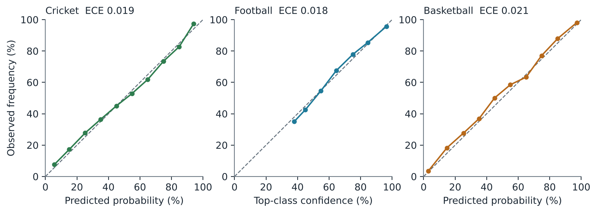
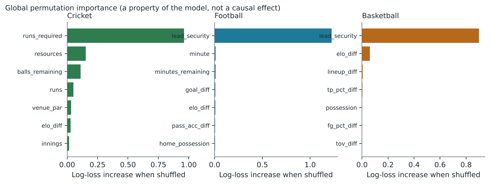
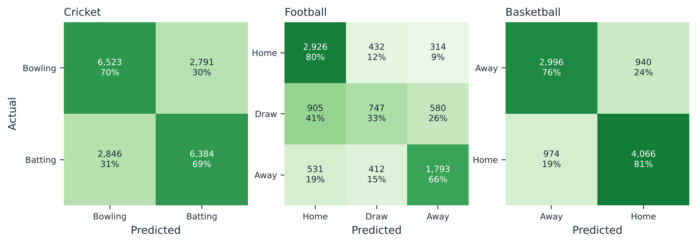

**Keywords:** explainable AI; sports analytics; win probability; what-if simulation; human–computer interaction; usability; trust in AI; synthetic data.

# Abstract

Sports predictions are usually shown as a bare probability, which gives users nothing to question and nothing to explore. We present SPORTS AI, a prototype platform for cricket, football and basketball that pairs calibrated win-probability models with additive feature explanations, an interpretable momentum index, a what-if simulation that re-runs the real prediction pipeline, and a rollout-based "AI-assisted recommendation" component. We also implement an HCI study module that compares a prediction-only interface (A) with an interactive, explainable interface (B) using tasks whose ground truth is computed from the same pipeline.

**Scope of the evidence.** All data are *synthetic*: they come from seeded simulators because real data were not available in the build environment. The reported machine-learning results ("synthetic benchmark results") therefore show that the pipeline behaves as designed, with chronological match-grouped evaluation and well-calibrated outputs (test ROC-AUC {{sports.cricket.final.test.roc_auc}} cricket, {{sports.football.final.test.roc_auc}} football one-vs-rest, {{sports.basketball.final.test.roc_auc}} basketball; expected calibration error at most {{sports.basketball.final.test.ece}}). They do not measure real-world forecasting skill. **No human-participant results have been collected for this version**; the paper specifies the study protocol and analysis plan, and the hypotheses are untested.

# 1 Introduction

A win probability such as "62%" is easy to read and hard to interrogate. A reader cannot tell which parts of the match state drive the number, how fragile it is, or what would change it. Explainable AI (XAI) and interactive what-if tools are natural responses [1], [2], but whether they actually improve people's understanding and decisions is an empirical question that has to be tested with people rather than assumed [3], [6], [7].

This project builds a single system in which the model, the explanation, the simulation and the evaluation instrument share one prediction pipeline. What a participant sees in the study interface is therefore exactly what the model computes, and the "correct answer" to each study task is derived from that same model rather than written by hand.

# 2 Problem statement and contributions

**Problem.** Give non-expert users a way to (i) see which side is favoured, (ii) understand why, (iii) test "what if" changes, and (iv) do so in an interface whose effect on understanding, confidence, trust and usability can be measured.

**Contributions** of this prototype:

1. A *Sport Adapter* architecture with three implemented sports (cricket, football, basketball) behind one API.
2. A leakage-aware training protocol (chronological, match-grouped splits; pre-match ratings updated only after a match ends) with a simplicity-preferring model-selection rule and calibration checks.
3. Additive, deterministic Shapley-style explanations [1], [2] on the probability scale, including attribution of a *change* in probability to the features an event altered.
4. A what-if simulation and an AI-assisted recommendation component that reuse the same models and simulators.
5. An HCI study module with objective ground truth, counterbalanced assignment, SUS and study-specific trust items, anonymous data capture and CSV/JSON export, plus an analysis script.
6. A candid account of what is *not* shown: no real data, no human-participant results.

# 3 Research question and hypotheses

**RQ.** Compared with a prediction-only dashboard, how does an interactive and explainable sports-analytics interface affect users' decision accuracy, task-completion time, confidence, perceived trust in AI and perceived usability when interpreting sports-match predictions?

The following are **hypotheses, not findings**. They remain untested until real participants are run.

| ID | Hypothesis |
|---|---|
| H1 | Users of Interface B answer prediction-interpretation tasks more accurately than users of Interface A. |
| H2 | Interface B improves users' ability to identify the main factor behind a prediction. |
| H3 | Interface B may raise confidence and perceived usability; trust is measured, not assumed to rise. |
| H4 | What-if simulation helps users reason about changes in match state but may add interaction time or cognitive load. |

# 4 Related work

*Win probability in sport.* Models of in-play win probability range from Brownian-motion models of score progression [9], through resource-based target resetting in limited-overs cricket [11], to machine-learning models such as random forests for American football [10]. We use standard supervised models on hand-built state features rather than proposing a new forecasting method.

*Explanation and its evaluation.* Shapley-value feature contributions for individual predictions were introduced for model explanation in [1] and unified with related methods in [2]. Doshi-Velez and Kim argue that interpretability needs rigorous, including human-grounded, evaluation [3]; Miller draws on social-science work on how people explain [4]; and Hoffman et al. discuss metrics for judging explanations, including understanding and trust [5]. Controlled studies manipulate model transparency or explanations and measure human outcomes [6], [7]. We follow this stance: we do not assume that explanations help, and we state hypotheses openly (§3).

*Uncertainty communication.* Evaluating how uncertainty is displayed is itself a research topic [8]. Our interface shows a model-disagreement band; we describe it as model uncertainty only and do not claim that it conveys outcome uncertainty.

*Probability quality.* We report the Brier score [13] and reliability diagrams, and use calibration practice in the spirit of [12].

*Usability.* We use the System Usability Scale [14].

This is a narrative, not a systematic, review. Citation verification status is recorded in `research/REFERENCES_NOTES.md`.

# 5 System design

Figure 1 shows the architecture. A React/TypeScript single-page app calls a FastAPI service. Services use a `SportAdapter` that supplies, per sport, a validated state model, the feature function (shared by training and serving), event transitions for simulation, a momentum index and insights. Trained artifacts are loaded at start-up; training is offline. Request validation, rate limiting, CORS control and structured errors are implemented. Authentication is not.

The interface has eight connected pages: Landing, Sport Selection, Match Center, AI Analytics, Simulation Lab, Player Lab, Model Insights and HCI Study. Every page handles loading, error (with retry) and empty states, and a persistent "SYNTHETIC DEMO DATA" badge marks all views.

# 6 Data generation and features

**Statement.** *All data in this work are synthetic.* Three seeded simulators generate matches: a ball-by-ball T20 model (venue par, chase aggression, wickets-and-balls resources), a minute-by-minute football shot and expected-goals (xG) process, and a possession-by-possession basketball model. Football xG is a *synthetic* quantity defined by the simulator and is not a measured xG. Pre-match team strength is an Elo rating that is updated only after each simulated match. A player simulator generates {{players.cricket_runs.dataset.players}} careers per sport for next-game prediction. Snapshots are taken after every over (cricket), every 5 minutes (football) and every 2 minutes (basketball).

<!--TABLE:datasets-->

*Table 1. Synthetic training tables (generated by `app/ml/train_all.py`; sample CSVs in `data/synthetic/`).*

Cricket uses one model for both innings: the state label is "the current batting side wins the match", and in the first innings the "target" feature is replaced by the venue par score so that the model never sees a realised total. This does not claim that one label covers every cricket format; the supported scenario is T20.

# 7 Machine-learning methodology

**Splits and leakage control.** Matches are ordered by date and split 70/15/15, with all snapshots of a match in a single split. Features use only information available at the snapshot (score, balls or minutes left, recent window, resources, pre-match rating). Labels and match identifiers are never model inputs; an automated test enforces this, and another checks that no snapshot contains final-state information. Scalers are fitted on the training split only; the test split is used once for reporting.

**Models and selection.** Logistic regression, random forest, histogram gradient boosting and XGBoost are compared by validation log-loss. If a simpler model is within 1% of the best, the simpler model is chosen. Isotonic calibration is kept only if it improves validation log-loss. A 12-member match-cluster bootstrap ensemble gives a band that reflects *model* disagreement only. Player targets use ridge or Poisson regression versus tree ensembles, and report empirical 10th–90th percentile residual ranges.

**Metrics.** Classification: accuracy, precision, recall, F1, ROC-AUC (one-vs-rest macro for the 3-class football task), Brier score, log-loss and expected calibration error (ECE). Regression (player statistics only): MAE, RMSE and R².

# 8 Explainability, momentum and simulation

**Explanations.** For a state *x* the contribution of each feature is estimated by permutation sampling (16 permutations, 6 background rows, fixed seed) on the *probability* scale, so the base probability plus the contributions equals the prediction [1], [2]. A "simple" view turns the largest contributions into sentences; a "technical" view lists values and contributions. Global permutation importance (Figure 5) is shown separately and labelled as a property of the model, not a causal effect.

**Change attribution.** For an event that changes *x* into *x′*, the difference *f*(*x′*) − *f*(*x*) is attributed to the features the event changed.

**Momentum.** Momentum is a *deterministic, hand-weighted heuristic*, not a learned model: M = 50 + 50·tanh(Σ wᵢzᵢ) over standardised, named factors (for example required-rate pressure, recent scoring tempo, wicket pressure, shot volume). Factor points are the proportional split of (M − 50). It is bounded to 0–100 by construction and tested; the weights are not fitted to data.

**What-if simulation.** A selected event is applied by deterministic state transitions, the state is re-validated, features are recomputed and the *same predictor* is called again; no percentage is added to the displayed probability. Counter-intuitive movements, if they occur, are reported rather than corrected.

**AI-assisted recommendation.** Candidate actions are evaluated by Monte-Carlo rollouts with the same simulators, end states are scored by the model, and actions are ranked by expected win probability (expected points in football). Confidence is Φ(z) of the best-versus-runner-up margin, clipped to [0.5, 0.99]. Output is worded as an AI-assisted possibility with a disclaimer; it is demonstrative decision support and not a guaranteed strategy.

# 9 HCI conditions and experimental protocol

**Design.** Between-subjects: each participant sees one interface for all tasks. Assignment alternates A, B, A, B (balanced groups); task order is rotated per participant (a simple Latin-square rotation) and the position is recorded to allow order effects to be checked. Both groups see the same model and the same scenarios, so difficulty is equal across conditions.

**Tasks (Appendix A).** Five tasks: choose the favoured side; identify the dominant factor (two tasks, one cricket, one football); choose the event with the largest positive effect (cricket); choose the event with the largest negative effect (basketball). Ground truth is computed on the server from the pipeline (largest-magnitude Shapley contribution; maximum or minimum of an event sweep). Each task records confidence (1–7) and a single-item trust rating (1–7).

**Measures.** Task time; decision accuracy; confidence; single-item trust; number of interactions; the 10-item SUS [14] (standard scoring); four *study-specific* trust items (Appendix B), which are **not** a validated scale; optional free-text feedback.

**Analysis plan.** The unit of analysis is the participant. Welch's t-test, Mann–Whitney U and Cohen's *d* with a bootstrap confidence interval are computed per measure by `scripts/analyze_hci.py`; no inferential statistics are produced for groups smaller than a stated minimum or for empty data. With several measures and small samples, any single p-value is exploratory.

**Ethics and privacy (summary; see §12).** Anonymous codes, consent text and withdrawal notice; no names, emails, IDs or locations; export as CSV/JSON.

# 10 Results

## 10.1 Synthetic benchmark results (machine learning)

These are **synthetic benchmark results**. They validate the pipeline on simulator data and do not establish real-world forecasting performance.

<!--TABLE:win_probability_test-->

*Table 2. Held-out test results for the selected win-probability models.*

All three models improve on the prior log-loss ({{sports.cricket.baseline.prior_log_loss}}, {{sports.football.baseline.prior_log_loss}} and {{sports.basketball.baseline.prior_log_loss}}). Logistic regression was selected in every sport. On the cricket test split XGBoost reached log-loss {{sports.cricket.comparison.xgboost.test.log_loss|3}} against {{sports.cricket.comparison.logistic_regression.test.log_loss|3}} for logistic regression, but the validation gap was within the 1% tolerance, so the simpler model was kept (Table 3, Figure 3). We attribute the competitiveness of linear models to the near log-linear structure of the simulators; the result should not be read as evidence that linear models beat boosting on real sport.

<!--TABLE:algorithm_comparison-->

*Table 3. Algorithm comparison (validation and test).*

Calibration is good by construction of the simulators (Figure 4; ECE {{sports.cricket.final.test.ece}} cricket, {{sports.football.final.test.ece}} football, {{sports.basketball.final.test.ece}} basketball). Isotonic calibration did not improve validation log-loss in any sport (for football, {{sports.football.calibration_check.raw_val_ll|3}} raw versus {{sports.football.calibration_check.calibrated_val_ll|3}} calibrated), so it was not applied.

The football model rarely predicts a draw correctly (Figure 6), as is typical for the minority class of a 3-way outcome.

<!--TABLE:player_models_test-->

*Table 4. Player models on held-out later games.*

Single-game counts are noisy: R² is {{players.cricket_wickets.final.test.r2}} for wickets and {{players.football_assists.final.test.r2}} for assists, barely above a mean predictor, and the cricket 50+ classifier's accuracy ({{players.cricket_p50.final.test.accuracy}}) is close to the majority-class rate ({{players.cricket_p50.baseline.majority_accuracy}}) with recall {{players.cricket_p50.final.test.recall}} at a 0.5 threshold. Basketball volume statistics are comparatively predictable (points R² {{players.basketball_points.final.test.r2}}). The interface therefore shows ranges and labels outputs "PREDICTION" versus "ACTUAL RESULT".

## 10.2 Automated checks

The backend test suite (pytest) checks probability validity, additivity and determinism of the explanations, leakage safeguards, simulation passing altered features through the model, momentum bounds, input validation and edge cases, HCI scoring and export, and graceful handling of missing artifacts. The frontend has unit tests for shared components and a production build and type check. Counts and outcomes are listed in `docs/ACCEPTANCE_CHECKLIST.md`.

## 10.3 Human-participant results

**No human-participant results have been collected for this version.** The HCI module has been exercised only with throw-away test sessions that were deleted, and the analysis script has been demonstrated only on clearly labelled simulated rows. None of those are reported here, and nothing in this paper should be read as evidence for or against H1–H4.

# 11 Discussion, validity threats and limitations

*Design implications (hypotheses for study, not findings).* The prototype suggests an interaction pattern in which the explanation sits one click from the number and the what-if control sits next to it, so a user can ask "why?" and "what if?" without leaving the screen.

*Threats to validity.*

1. **Synthetic data.** Train, validation and test data come from the same simplified dynamics, so absolute metrics overstate what real data would give.
2. **Model-selection outcome.** Linear models winning is a property of the simulators.
3. **Weak player targets.** Several player count targets barely beat a mean predictor.
4. **Bootstrap band.** It reflects training variance only, not outcome uncertainty.
5. **Recommendation realism.** Rollouts use the same simplified simulators.
6. **Heuristic momentum.** Weights are hand-set.
7. **Illustrative visuals.** Shot positions, wagon-wheel angles and pitch-map lengths are generated from outcomes; no model predicts them.
8. **Package effect.** Interface B differs from A in content and interaction opportunity, so any future effect is a bundle effect and cannot be attributed to explanations alone.
9. **Study size.** The protocol is sized for a student project; it does not claim statistical power.
10. **Untested deployment paths.** PostgreSQL, Docker, Render and Vercel configurations were written but not run against live services.

# 12 Ethical and privacy considerations

The study module records an anonymous participant code, assigned interface, answers, timings, ratings, questionnaire responses and optional comments; it does not record names, emails, student IDs or locations. Consent text and a voluntary-withdrawal notice are shown before a session starts, and a session cannot begin without consent. **This work does not claim ethics approval or institutional review.** Any real participant study must follow the course or institution's approval and consent requirements. Exports are neutralised against spreadsheet formula injection. Simulated rows are labelled and are never to be combined with participant data.

# 13 Conclusion and future work

SPORTS AI demonstrates an explainable, simulation-capable analytics pipeline with a leakage-aware evaluation protocol and a ready instrument for studying how explanations affect users. The essential next steps are (i) running the HCI study with approved consent procedures and analysing it with the provided script, (ii) retraining on real open datasets subject to their licences, (iii) fitting momentum weights and validating the recommendation component against real outcomes, and (iv) separating the effects of explanation and interactivity with a factorial design.

# References

[1] E. Štrumbelj and I. Kononenko, "Explaining prediction models and individual predictions with feature contributions," *Knowledge and Information Systems*, vol. 41, no. 3, pp. 647–665, Dec. 2014, doi: 10.1007/s10115-013-0679-x.

[2] S. M. Lundberg and S.-I. Lee, "A unified approach to interpreting model predictions," in *Advances in Neural Information Processing Systems 30 (NIPS 2017)*, 2017. [Online]. Available: https://papers.nips.cc/paper/7062-a

[3] F. Doshi-Velez and B. Kim, "Towards a rigorous science of interpretable machine learning," arXiv:1702.08608, 2017.

[4] T. Miller, "Explanation in artificial intelligence: Insights from the social sciences," *Artificial Intelligence*, vol. 267, pp. 1–38, Feb. 2019, doi: 10.1016/j.artint.2018.07.007.

[5] R. R. Hoffman, S. T. Mueller, G. Klein and J. Litman, "Metrics for explainable AI: Challenges and prospects," arXiv:1812.04608, 2018.

[6] F. Poursabzi-Sangdeh, D. G. Goldstein, J. M. Hofman, J. Wortman Vaughan and H. Wallach, "Manipulating and measuring model interpretability," in *Proc. CHI 2021*; preprint arXiv:1802.07810. (Page numbers and DOI not verified.)

[7] G. Bansal, T. Wu, J. Zhou, R. Fok, B. Nushi, E. Kamar, M. T. Ribeiro and D. S. Weld, "Does the whole exceed its parts? The effect of AI explanations on complementary team performance," arXiv:2006.14779. (Venue and year of the published version to be confirmed.)

[8] J. Hullman, X. Qiao, M. Correll, A. Kale and M. Kay, "In pursuit of error: A survey of uncertainty visualization evaluation," *IEEE Trans. Visualization and Computer Graphics* (Proc. InfoVis 2018). (Volume, pages and DOI not verified.)

[9] H. S. Stern, "A Brownian motion model for the progress of sports scores," *Journal of the American Statistical Association*, vol. 89, no. 427, pp. 1128–1134, Sep. 1994.

[10] D. Lock and D. Nettleton, "Using random forests to estimate win probability before each play of an NFL game," *Journal of Quantitative Analysis in Sports*, vol. 10, no. 2, pp. 197–205, Jun. 2014, doi: 10.1515/jqas-2013-0100.

[11] F. C. Duckworth and A. J. Lewis, "A fair method for resetting the target in interrupted one-day cricket matches," *Journal of the Operational Research Society*, vol. 49, no. 3, pp. 220–227, 1998. (Author order differs between catalogue records; DOI not verified.)

[12] A. Niculescu-Mizil and R. Caruana, "Predicting good probabilities with supervised learning," in *Proc. 22nd International Conference on Machine Learning (ICML)*, 2005, pp. 625–632, doi: 10.1145/1102351.1102430.

[13] G. W. Brier, "Verification of forecasts expressed in terms of probability," *Monthly Weather Review*, vol. 78, no. 1, pp. 1–3, 1950, doi: 10.1175/1520-0493(1950)078<0001:VOFEIT>2.0.CO;2.

[14] J. Brooke, "SUS: A 'quick and dirty' usability scale," in *Usability Evaluation in Industry*, 1996. (Editors, publisher and page range not verified.)

# Appendix A: Study tasks and ground truth

| ID | Sport | Task | Ground truth rule |
|---|---|---|---|
| T1 | Cricket | Which side is favoured to win? | Side with probability ≥ 55%; "too close to call" if 45–55% |
| T2 | Cricket | Which factor has the largest influence on the current win probability? | Feature with the largest-magnitude Shapley contribution |
| T3 | Cricket | Which event would increase the batting side's win probability most? | Maximum of the event sweep among the four options |
| T4 | Basketball | Which event would reduce the home team's win probability most? | Minimum of the event sweep among the four options |
| T5 | Football | Which factor is the main driver of the home-win probability? | Feature with the largest-magnitude Shapley contribution |

# Appendix B: Questionnaire items

**SUS** (1–5): the ten standard items, scored as in [14].

**Study-specific trust items** (1–7; *not a validated scale*):

1. I understood why the system gave the prediction it showed.
2. I would rely on this prediction when making a decision about this match.
3. I could tell when the prediction might be wrong or uncertain.
4. I felt the prediction was trustworthy.

# Appendix C: Model features

Feature names per sport are listed in `backend/artifacts/metrics.json` (`sports.<sport>.features`) and described in `docs/ML_DOCUMENTATION.md`.
